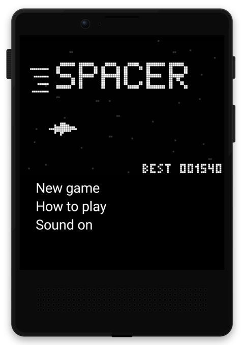
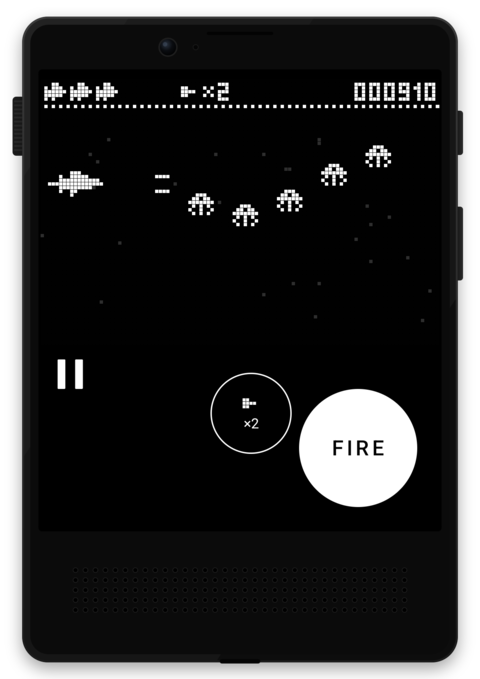

# Spacer

A side-scrolling space shooter for the Light Phone III, drawn in 1-bit pixels like the phone games of the early 2000s. Five stages, five guardians, and then the mission is over.

<p align="center">
  
  
</p>

- Five stages: open space, ice caves with gun turrets, a field of drifting wreckage, an overgrown hive, and the core. Each ends with its own guardian, which has a weak point and attacks harder as it weakens.
- Slide a finger anywhere to fly. The ship follows the slide, so your finger never covers it. Hold FIRE to shoot. On the phone, the volume keys also steer and the camera button fires.
- Three special weapons: seeker missiles, a lance beam and a nova shockwave. Shoot down carriers for those, extra ships and more guns.
- Lose every ship and you can try the stage again from its start. The game pauses itself when you leave it.
- Arcade sound, synthesised on the phone like an old sound chip: a short blip for each shot, a noise pop for each enemy destroyed, and chiptune jingles in a Japanese pentatonic scale. It follows the ringer volume, so silent mode silences it, and music keeps playing underneath. Turn it off on the title screen.
- All art is drawn for this game: a 108 × 72 pixel screen scaled up with a faint LCD grid, following the LightOS light or dark theme.

## Credits

Inspired by the side-scrolling shooters on mobile phones of the early 2000s, Nokia's Space Impact above all. Spacer is an independent game: its name, art, stages, guardians and sounds were all made for it. It is not affiliated with or endorsed by Nokia.

## Privacy

No account, no tracking, no analytics, no ads, and no network access. The tool asks for no permissions beyond the vibration the SDK already includes. Your best score and the stage you reached stay on the phone.

## License

MIT, see `LICENSE`.

## Build

This repo holds only the `tool/` module. Copy it into a checkout of [light-sdk](https://github.com/lightphone/light-sdk), replacing its `tool/`, then:

```sh
./gradlew :tool:testDebugUnitTest :tool:assembleRelease
```

The game logic is plain Kotlin stepped at a fixed 60 ticks a second. The unit tests include a bot that plays all five stages to the end. `ArtSheetTest` and `SceneSheetTest` render the sprites and a frame from every stage to `build/art/` for reviewing the art.
